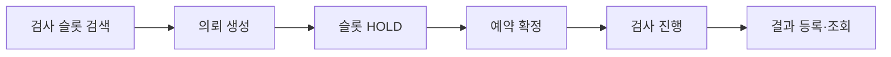
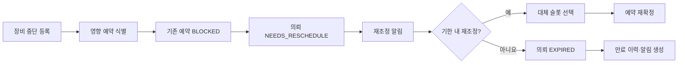
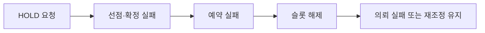
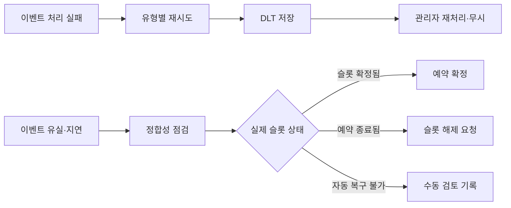
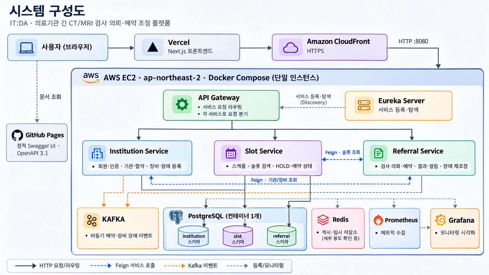
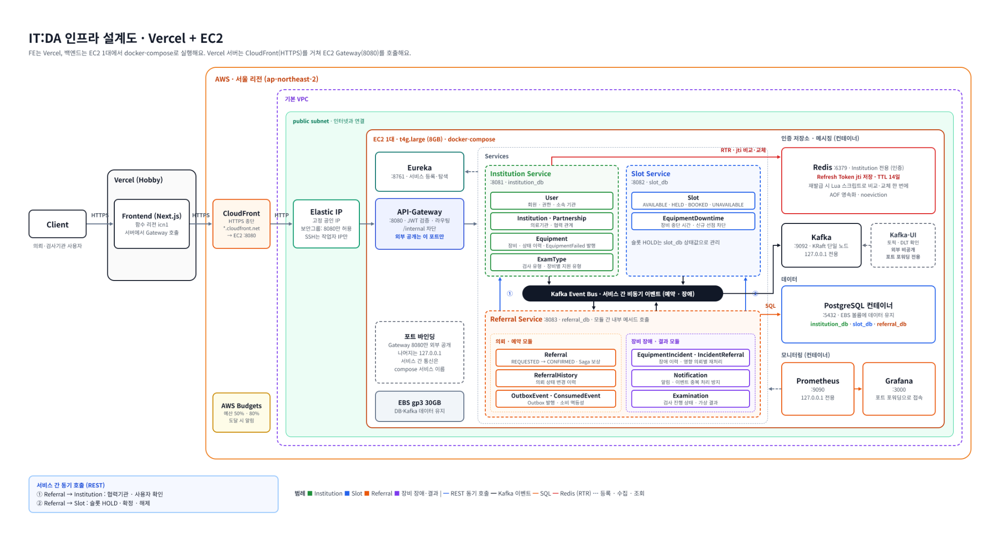
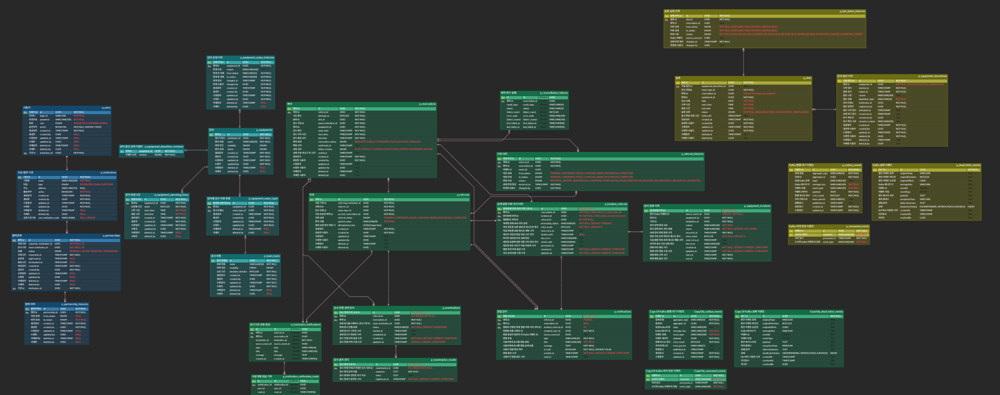

# IT:DA — 영상검사 의뢰·예약 관리 플랫폼

> 의료기관 간 CT·MRI 검사 의뢰부터 슬롯 선점, 예약 확정, 검사 진행, 장비 장애에 따른 재조정까지 연결하는 B2B 의료 협력 플랫폼

## 목차

1. [프로젝트 소개](#1-프로젝트-소개)
2. [주요 기능 및 업무 흐름](#2-주요-기능-및-업무-흐름)
3. [기술 스택](#3-기술-스택)
4. [시스템 아키텍처](#4-시스템-아키텍처)
5. [프로젝트 구조](#5-프로젝트-구조)
6. [로컬 실행 방법](#6-로컬-실행-방법)
7. [테스트 및 CI](#7-테스트-및-ci)
8. [배포 및 운영](#8-배포-및-운영)
9. [트러블슈팅 및 기술적 개선](#9-트러블슈팅-및-기술적-개선)
10. [향후 개선 사항](#10-향후-개선-사항)

---

## 1. 프로젝트 소개

### 1.1 서비스 소개

**의료기관 간 검사 의뢰부터 예약, 검사 진행까지 연결하는 B2B 의료 협력 플랫폼**

IT:DA는 협력 의료기관 간 CT·MRI 등 검사 의뢰부터 예약, 검사 진행 상태 확인까지의 업무를 연결하는 플랫폼입니다.

의뢰기관은 협력 검사기관의 장비와 검사 가능 슬롯을 확인하고 검사를 의뢰할 수 있습니다. 검사기관은 예약을 확정하고 검사 진행 및 결과를 관리합니다.

기존 의료기관 간 분리된 업무 흐름을 연결하고, 동일 슬롯에 대한 중복 예약, 장비 장애에 따른 예약 재조정, 분산 환경의 메시지 처리 실패와 데이터 불일치 문제를 해결하는 데 중점을 두었습니다. 또한 재조정 기한이
지나도 처리되지 않은 의뢰가 계속 활성 상태에 남지 않도록 만료 상태 및 이력 관리 기능을 추가했습니다.

#### 서비스 바로가기

- [서비스](https://itda-frontend-one.vercel.app/)
- [FrontEnd Repository](https://github.com/HEALO-WORLD/ITDA-frontend)
- [API 문서](https://healo-world.github.io/ITDA)

### 1.2 사용자 유형

| 역할        | 사용자          | 주요 업무                                                             |
|-------------|-----------------|-----------------------------------------------------------------------|
| `REQUESTER` | 의뢰기관 담당자 | 협력기관 조회, 슬롯 검색, 검사 의뢰·예약, 예약 취소·재조정, 결과 확인 |
| `EXAMINER`  | 검사기관 담당자 | 장비·운영시간·슬롯 관리, 검사 진행·결과 등록, 장비 중단 관리          |
| `ADMIN`     | 플랫폼 관리자   | 사용자 승인, 기관·검사 유형 관리, 운영 및 실패 메시지 관리            |

### 1.3 팀 구성 및 역할

IT:DA는 5인 팀 프로젝트로, 의료기관 간 검사 의뢰 및 예약 업무를 중심으로 서비스를 분리하여 개발했습니다. 각자 담당 도메인을 구현하고, 서비스 간 API·이벤트 연동과 통합 테스트를 통해 전체 업무 흐름을
완성했습니다.

| 팀원       | 담당 영역                   | 주요 역할                                                                                     |
|------------|-----------------------------|-----------------------------------------------------------------------------------------------|
| **신다울** | 인증·인가 및 사용자 관리    | JWT 기반 로그인·토큰 관리, 사용자 인증·인가 및 역할별 접근 제어                               |
| **윤보영** | 장비 및 슬롯 관리           | 검사 장비·운영시간 관리, 슬롯 생성 및 조회 기능 구현                                          |
| **장수현** | 슬롯 동시성 제어 및 인프라  | 슬롯 HOLD 및 중복 예약 방지, Docker 기반 MSA 실행 환경 구성                                   |
| **조민영** | 검사 의뢰 및 예약           | 의뢰·예약 도메인 구현, Kafka 기반 예약 SAGA 및 상태 관리                                      |
| **김효진** | 장비 장애 대응 및 검사 관리 | 장비 중단 등록·연장·복구 및 영향 예약 처리, 검사 시작·진행 상태 관리 및 결과 등록, 알림·재조정 API 연동 |

## 2. 주요 기능 및 업무 흐름

### 2.1 주요 기능

| 주요 기능                      | 상세 설명                                                                                                |
|--------------------------------|----------------------------------------------------------------------------------------------------------|
| **사용자 인증 및 권한 관리**   | JWT 기반 로그인·회원가입, Refresh Token 재발급, `ADMIN`·`REQUESTER`·`EXAMINER` 역할별 API 접근 제어      |
| **의료기관 및 협약 관리**      | 의료기관 등록·조회, 사용자 승인, 의뢰기관과 검사기관 간 협약 신청·승인·거절·종료                         |
| **검사 장비 및 운영시간 관리** | CT·MRI 장비 등록, 검사 유형·소요시간 및 운영시간 설정, 장비 상태 관리                                    |
| **검사 슬롯 생성 및 검색**     | 장비 운영시간에 따른 슬롯 생성, 기관·검사 유형·날짜·장비별 가용 슬롯 검색, 중복 시간대 생성 방지         |
| **검사 의뢰 및 예약 확정**     | 검사 의뢰 생성, 5분간 슬롯 선점(HOLD), Kafka 기반 예약 확정, 멱등성 키를 통한 중복 의뢰 방지             |
| **예약 취소 및 재조정**        | 예약 취소 및 슬롯 해제, 장애 발생 시 대체 슬롯을 이용한 재예약, 예약·의뢰 상태 및 변경 이력 관리         |
| **재조정 기한 만료 처리**      | 기한을 넘긴 `NEEDS_RESCHEDULE` 의뢰의 `EXPIRED` 자동 전환, 만료 이력·알림 생성, 기존 예약·검사 기록 보존 |
| **장비 장애 및 복구 관리**     | 장비 중단 등록·연장·복구, 장애 시간대의 슬롯 차단, 영향 예약 식별 및 재조정 대상 처리                    |
| **검사 진행 및 결과 관리**     | 예약에 연결된 검사 생성, 검사 진행 상태 변경, 검사 결과 등록 및 의뢰기관 결과 조회                       |
| **알림 관리**                  | 예약 확정·취소, 재조정 필요·기한 만료 알림 생성, 기관별 알림 조회 및 사용자별 읽음 상태 관리             |
| **비동기 처리 및 장애 복구**   | Kafka Outbox·Inbox 기반 이벤트 처리, 실패 이벤트 DLT 관리, 관리자 재처리 및 예약 상태 정합성 점검        |

### 2.2 정상 의뢰 및 예약 확정



의뢰기관이 검사 슬롯을 선택해 의뢰를 생성하면 Kafka 기반 비동기 처리로 슬롯 선점 및 예약 확정이 진행됩니다.

### 2.3 장비 장애 및 예약 재조정



장비 장애로 영향을 받은 예약을 식별하고, 의뢰기관이 대체 슬롯을 선택하여 예약을 재조정할 수 있도록 지원합니다. 기한 내 재조정되지 않은 의뢰는 종료 상태인 `EXPIRED`로 전환되어 재조정 대상에서 제외됩니다.

- **정상 재조정:** 대체 슬롯을 선택해 재예약을 요청하고, 비동기 처리 결과를 확인한 뒤 예약을 확정합니다.
- **기한 만료:** `max(차단 예약의 검사 시작 시각, 차단 시각) + 48시간`을 기준으로 만료 여부를 판단합니다.
- **이력 보존:** 의뢰에 `RESCHEDULE_TIMEOUT` 이력을 기록하고 `RESCHEDULE_EXPIRED` 알림을 생성합니다. 기존 `BLOCKED` 예약과 검사 기록은 삭제하거나 변경하지 않습니다.
- **안전한 운영:** 자동 만료 스케줄러는 기본 비활성화되며, 운영 데이터 확인 후 별도로 활성화합니다.

### 2.4 예약 실패·보상 및 이벤트 복구

**예약 실패·보상 흐름**



**이벤트 처리 실패·복구 흐름**



### 2.5 상세 업무 시나리오

Kafka 이벤트 처리, Saga 보상 및 장애 복구 과정을 포함한 상세 시퀀스 다이어그램은 아래 문서에서 확인할 수 있습니다.

**[상세 업무 시나리오 문서 보기](docs/SCENARIOS.md)**

서비스 간 데이터 정합성이 중요한 예약 처리에는 Kafka 기반 이벤트와 보상 처리를 적용하고, 장애 상황에서는 후속 처리 및 정합성 점검을 통해 예약 상태의 일관성을 유지하도록 구성했습니다.

## 3. 기술 스택

| 구분       | 기술                                                      |
|------------|-----------------------------------------------------------|
| Backend    | Java 21, Spring Boot 4.1.2, Spring Cloud 2025.1.4         |
| MSA        | Spring Cloud Gateway, Netflix Eureka, OpenFeign           |
| Database   | PostgreSQL 18, Redis 8.10.3                               |
| Messaging  | Apache Kafka 4.4.0, Spring Kafka                          |
| Security   | Spring Security, JWT (JJWT 0.12.7)                        |
| Monitoring | Prometheus 3.15.1, Grafana 13.2.4, Micrometer             |
| Test       | JUnit, Testcontainers, k6                                 |
| Infra      | Docker, Docker Compose, AWS EC2                           |
| CI/CD      | GitHub Actions, AWS IAM (OIDC), AWS Systems Manager (SSM) |
| Frontend   | Next.js, React, Typescript, Vercel                        |

## 4. 시스템 아키텍처

### 4.1 전체 시스템 구성도

의뢰기관·검사기관 사용자는 Next.js 프론트엔드에서 업무를 처리하며, 백엔드는 Spring Cloud Gateway를 중심으로 Institution, Slot, Referral Service를 분리했습니다.
서비스 간 동기 조회는 OpenFeign, 예약 및 장비 장애 관련 비동기 이벤트는 Kafka를 사용합니다.

[](images/system-architecture.png)

*그림 1. 전체 시스템 구성 — 프론트엔드, API Gateway, 서비스 분리 및 Kafka·데이터베이스·모니터링 구성. [원본 확대](images/system-architecture.png)*

### 4.2 인프라 배포 구조

프론트엔드는 Vercel에, 백엔드는 서울 리전 (`ap-northeast-2`)의 EC2 단일 인스턴스에 Docker Compose로 배포합니다. 프론트엔드의 서버 측 API 요청은 CloudFront
(HTTPS)를 거쳐 EC2의 Gateway (HTTP 8080)로 전달됩니다.

[](images/infrastructure-architecture.png)

*그림 2. 인프라 배포 설계 — Vercel, CloudFront, EC2 내 서비스·컨테이너 및 배포·모니터링
요소. [원본 확대](images/infrastructure-architecture.png)*

- **서비스 분리:** Institution, Slot, Referral Service별 논리 데이터베이스 (`institution_db`, `slot_db`, `referral_db`)를 분리합니다. 개발·배포
  Compose에서는 PostgreSQL 컨테이너 하나를 공유합니다.
- **서비스 통신:** OpenFeign 동기 조회와 Kafka 비동기 이벤트 처리를 구분합니다.
- **운영 구성:** Prometheus·Grafana로 메트릭을 확인하고, Kafka UI로 이벤트 흐름을 점검합니다.

### 4.3 핵심 기술 및 설계

| 핵심 기술                  | 설명                                                       |
|----------------------------|------------------------------------------------------------|
| MSA                        | 서비스별 책임과 데이터베이스 경계 분리                     |
| Kafka 기반 비동기 처리     | 예약 SAGA 및 서비스 간 이벤트 처리                         |
| 이벤트 정합성 관리         | Transactional Outbox·Inbox 기반 중복 처리 방지             |
| 예약 동시성 제어           | PostgreSQL 조건부 UPDATE 및 Advisory Lock                  |
| 장애 복구 및 데이터 정합성 | 재시도, DLT, 예약 상태 점검 및 재처리                      |
| 장비 장애 대응             | 장애 영향 예약 식별, 재조정 및 기한 만료 처리              |
| 인증 및 접근 제어          | Gateway JWT 검증, 역할별 접근 제어 및 서비스별 소유권 검증 |

### 4.4 ERD

서비스별 데이터 모델과 예약·의뢰·검사 상태 이력 및 비동기 이벤트 저장 구조를 함께 확인할 수 있습니다. 큰 이미지이므로 클릭해 원본 크기로 확인하는 것을 권장합니다.

[](images/database-erd.png)

*그림 3. 전체 ERD — 기관, 슬롯, 의뢰·예약·검사, 알림, 이벤트 저장 테이블 및 연관관계. [원본 확대](images/database-erd.png)*

**[ERD Cloud에서 상세 보기](https://www.erdcloud.com/d/RGJ34Gzm2mHLBqr73)**

## 5. 프로젝트 구조

```
ITDA/
├── eureka-server/             # 서비스 등록 및 탐색
├── gateway-service/           # API 라우팅, JWT 인증 및 통합 Swagger
├── institution-service/       # 회원, 기관, 협약, 장비 관리
├── slot-service/              # 검사 슬롯, HOLD, 장비 중단 관리
├── referral-service/          # 검사 의뢰, 예약, 검사 및 후속 처리
├── docs/
│   ├── images/                # 시스템 구성도·인프라 설계도·ERD 이미지
│   └── SCENARIOS.md           # 상세 업무 시나리오
├── docker/
│   ├── postgres/init.sql      # 서비스별 데이터베이스 초기화
│   ├── prometheus/            # 메트릭 수집 설정
│   └── grafana/               # 대시보드 및 데이터소스 설정
├── load-test/
│   ├── k6/                    # 예약 SAGA 부하 테스트
│   └── sql/                   # 테스트 데이터 및 SQL 스크립트
├── .github/workflows/
│   ├── ci.yml                 # PR 빌드·테스트
│   └── deploy.yml             # main push 시 AWS SSM 기반 EC2 자동 배포
├── .env.example               # 환경변수 예시
├── docker-compose.yml         # 데이터베이스 및 메시징·모니터링 환경
├── docker-compose.app.yml     # MSA 애플리케이션 실행 환경
└── README.md
```

## 6. 로컬 실행 방법

### 6.1 사전 준비

- Git
- Docker Engine
- Docker Compose
- Java 21 (IDE·로컬 Gradle 실행 시)

### 6.2 저장소 내려받기

```bash
git clone https://github.com/HEALO-WORLD/ITDA.git
cd ITDA
```

### 6.3 환경변수 설정

루트 디렉터리의 `.env.example`을 복사하여 `.env` 파일을 생성합니다.

```bash
# macOS / Linux
cp .env.example .env
```

```powershell
# Windows PowerShell
Copy-Item .env.example .env
```

`.env` 파일을 열어 환경에 맞는 값을 설정합니다.

| 변수                                           | 용도                        | 주의사항                                   |
|------------------------------------------------|-----------------------------|--------------------------------------------|
| `POSTGRES_USER` / `POSTGRES_PASSWORD`          | PostgreSQL 인증             | 실제 자격 증명을 저장소에 커밋하지 않기    |
| `JWT_SECRET`                                   | JWT 서명·검증               | 개발·운영 환경마다 별도 관리               |
| `GRAFANA_ADMIN_PASSWORD`                       | Grafana 관리자 로그인       | 기본/빈 비밀번호 사용 금지                 |
| `SWAGGER_ENABLED`                              | Gateway 통합 Swagger 활성화 | 기본 `false`; 로컬에서만 선택적으로 `true` |
| `SEED_ENABLED`                                 | 개발용 데이터 초기화        | 기본 `never`; 실서비스에서는 활성화 금지   |
| `DEV_TOKEN_ENABLED`                            | 개발용 임시 토큰 API        | 기본 `false`; 실서비스에서는 활성화 금지   |
| `INCIDENT_PROCESSING_SCHEDULER_ENABLED`        | 장애 후속 처리 스케줄러     | 앱 Compose에서 `true` 설정                 |
| `RESERVATION_RECONCILIATION_SCHEDULER_ENABLED` | 예약 정합성 점검            | 앱 Compose에서 `true` 설정                 |
| `RESCHEDULE_EXPIRATION_SCHEDULER_ENABLED`      | 재조정 기한 만료 자동 종료  | 기본 `false`; 대상 확인 후 활성화          |
| `RESCHEDULE_EXPIRATION_GRACE_HOURS`            | 재조정 만료 유예 시간(시간) | 기본 `48`                                  |

> Docker Compose 전체 구동에서는 서비스 간 주소 (`DB_HOST`, `KAFKA_BOOTSTRAP_SERVERS`, `EUREKA_URL`, `REDIS_HOST`)를 Compose가 설정합니다.
> 로컬 IDE 실행 시에는 `localhost` 기본값을 사용하므로 `.env`에서 `DB_HOST=`처럼 빈 문자열로 덮어쓰지 않도록 주의합니다.
>

### 6.4 서비스 실행

**6.4.1 인프라 실행**

PostgreSQL, Redis, Kafka 및 모니터링 환경을 실행합니다.

```bash
docker compose up -d
```

**6.4.2 백엔드 전체 실행**

Eureka, Gateway 및 업무 서비스를 실행합니다.

```bash
docker compose -f docker-compose.yml -f docker-compose.app.yml up -d --build
```

**6.4.3 실행 상태 확인**

```bash
docker compose -f docker-compose.yml -f docker-compose.app.yml ps
```

**6.4.4 서비스 로그 조회**

```bash
docker compose -f docker-compose.yml -f docker-compose.app.yml logs --tail=100 gateway-service
```

`docker/postgres/init.sql`은 PostgreSQL 볼륨을 **처음 초기화할 때** `institution_db`, `slot_db`, `referral_db`를 생성합니다. 이미 생성된 DB
볼륨에는 다시 적용되지 않습니다.

#### 서비스 종료

```powershell
docker compose -f docker-compose.yml -f docker-compose.app.yml down
```

데이터 볼륨을 유지하려면 `-v` 옵션을 사용하지 않습니다.

### 6.5 서비스 포트 및 Swagger

| 서비스      | 접속 주소               | 비고                   |
|-------------|-------------------------|------------------------|
| Gateway     | `http://localhost:8080` | 외부 API 진입점        |
| Eureka      | `http://localhost:8761` | 서비스 등록 정보       |
| Institution | `http://localhost:8081` | 기관 서비스            |
| Slot        | `http://localhost:8082` | 슬롯 서비스            |
| Referral    | `http://localhost:8083` | 의뢰 서비스            |
| Kafka UI    | `http://localhost:8989` | Kafka 토픽·메시지 확인 |
| Prometheus  | `http://localhost:9090` | 메트릭 조회            |
| Grafana     | `http://localhost:3000` | 대시보드               |

**헬스 체크**

```bash
# Gateway Actuator는 별도 관리 포트 사용
curl http://localhost:18080/actuator/health

# 서비스별 헬스 체크
curl http://localhost:8081/actuator/health
curl http://localhost:8082/actuator/health
curl http://localhost:8083/actuator/health
```

#### Swagger API 문서

- Institution, Slot, Referral Service의 REST API 명세
- **OpenAPI:** [API 명세서 바로가기](https://healo-world.github.io/ITDA)
- **로컬 Swagger UI:** `http://localhost:8080/swagger-ui.html`
- **활성화 방법:** `.env`에서 `SWAGGER_ENABLED=true` 설정

공개 문서는 API 명세 확인용이며, 실제 API 호출은 백엔드 서버 연결 및 인증 설정에 따라 달라집니다.

## 7. 테스트

### 7.1 테스트 실행

각 서비스 디렉터리에서 Gradle Wrapper를 실행합니다.

```bash
# macOS / Linux
./gradlew clean build
```

```powershell
# Windows
.\gradlew.bat clean build
```

Testcontainers 기반 통합 테스트는 Docker 환경이 필요할 수 있습니다.

**주요 테스트:** 예약 동시성, 상태 전이, Kafka 중복 처리, 장비 장애 대응, 재조정 만료, 정합성 복구, 인증 및 권한 검증

## 8. 배포 및 운영

### 8.1 배포 구성

| 구분          | 환경                                               |
|---------------|----------------------------------------------------|
| 프론트엔드    | Vercel                                             |
| API 진입      | AWS CloudFront → Gateway                           |
| 백엔드        | AWS EC2, Docker Compose                            |
| 데이터·메시징 | PostgreSQL, Redis, Kafka                           |
| 모니터링      | Prometheus, Grafana, Kafka UI                      |
| 배포          | GitHub Actions → AWS SSM → EC2 (main push 시 자동) |

### 8.2 운영 관리

- **서비스 운영:** Docker Compose 기반 컨테이너 관리 및 헬스체크
- **모니터링:** Prometheus, Grafana를 통한 서비스 상태 및 주요 지표 확인
- **메시지 장애 대응:** DLT 조회 및 실패 메시지 재처리
- **접근 제어:** Gateway 중심 인증 및 내부 서비스 외부 접근 제한
- **재조정 만료:** 기본 비활성화된 스케줄러를 대상 데이터·백업·배포 상태 확인 후 활성화하여 만료 이력과 알림을 점검

**주의:** 운영 중인 DB·Kafka 볼륨과 수동 DDL, 서비스 기동 순서를 확인해야 합니다. 위 명령이 기존 DB 마이그레이션을 대체하는 것은 아닙니다.

### 8.3 CI/CD

#### CI - 지속적 통합

- `dev`, `main` 대상 PR에서 변경된 서비스별 빌드 및 테스트 수행
- Java 21 (Temurin) 및 Testcontainers 기반 테스트 환경
- 테스트 실패 시 리포트 아티팩트 업로드 및 최종 CI 결과 확인

#### CD - 지속적 배포

`main` 브랜치에 코드가 반영되면 `.github/workflows/deploy.yml`이 실행됩니다.

GitHub Actions는 OIDC를 통해 AWS IAM 역할의 임시 자격 증명을 발급받고, AWS Systems Manager (SSM) Run Command로 EC2에 배포 명령을 전달합니다.

EC2의 SSM Agent가 명령을 받아 최신 코드를 가져온 뒤, 변경된 서비스를 Docker Compose로 빌드·재기동합니다.

## 9. 트러블슈팅 및 기술적 개선

### 9.1 장비 장애와 예약 확정 이벤트의 순서 역전

**문제 상황**

장비 중단 이벤트를 처리하는 시점에 슬롯은 이미 `BOOKED`인데 Referral Service에서 확정 결과를 아직 반영하지 않았다면, 영향 예약 목록에서 누락될 가능성이 있습니다.

**개선 방법**

- 확정 결과를 반영하는 시점에도 해당 장비의 활성 장애와 예약을 연결
- 장비 중단 후속 처리를 별도의 작업·스케줄러로 관리
- 장비 상태 변경 이벤트에 증가하는 `revision`을 포함하여 역순·중복 전달에 대응
- 관리자가 설정한 수동 상태와 중단에 따른 상태를 분리해 복구 시 상태를 재계산

**의의:** 이벤트 수신 순서에 관계없이 영향 예약과 장비의 가용 상태를 재확인할 수 있도록 보완했습니다.

### 9.2 비동기 예약 Saga의 이벤트 지연·충돌·유실 대응

**문제 상황**

Kafka는 동일 파티션 내 메시지 순서를 보장하지만, 서로 다른 토픽·서비스에서 수행되는 비동기 처리의 완료 순서까지 보장하지는 않습니다. 예약 확정 과정에서 다음과 같은 상태 불일치 위험이 있었습니다.

- **늦게 도착:** 예약 종료 후 `SlotBooked` 이벤트를 처리하면 슬롯만 `BOOKED`로 남을 가능성
- **동시에 처리:** 이벤트 처리와 취소·재예약 API가 동일한 예약 상태를 변경하면 갱신 충돌 가능성
- **처리 실패:** 이벤트가 최종 실패하여 DLT로 이동하면 예약·슬롯이 중간 상태에 머무를 위험

**개선 방법**

- **보상 처리:** 종료된 예약에 `SlotBooked`가 오면 `ReleaseSlot`을 발행해 슬롯 해제 요청
- **조건부 상태 전이:** 현재 상태를 조건으로 UPDATE하고, 중복 이벤트는 `p_consumed_events`, 중복 요청은 멱등키로 처리
- **정합성 점검 스케줄러:** 예약·슬롯 상태를 비교하여 필요한 확정 반영 또는 슬롯 해제 재요청
- **DLT 보관·재처리:** 실패 메시지를 보관하고 관리자 재처리와 수동 검토 경로 제공

**의의:** 이벤트 지연·경합·처리 실패를 서로 다른 방식으로 대응하여 상태 불일치의 장기화를 줄이고, 자동 복구가 어려운 경우에도 추적·재처리할 수 있도록 개선했습니다.

### 9.3 슬롯 생성·예약 처리와 장비 중단 등록의 경합

**문제 상황**

슬롯 생성 요청이 장비를 사용할 수 있다고 확인한 직후, 다른 요청이 같은 장비의 점검 일정을 등록할 수 있습니다. 이때 먼저 확인한 결과를 그대로 사용하면 점검 시간에 슬롯이 생성될 수 있습니다. 슬롯 선점이나
예약 확정에서도 중단 여부를 확인한 시점과 실제로 상태를 바꾸는 시점 사이에 같은 문제가 발생될 수 있습니다.

**개선 방법**

- **장비 단위 잠금**
    - 슬롯 생성·선점·확정 -> 장비의 공유 잠금 사용 (같은 장비의 여러 슬롯은 동시에 선점 가능)
    - 장비 중단 등록·연장·복구 → 장비의 배타 잠금 사용 (진행 중인 슬롯 처리가 끝날 때까지 대기, 중단 정보가 반영될 때까지 새 슬롯 요청도 대기)
- **장비·날짜 단위 잠금:** 같은 장비와 날짜에 슬롯 생성 요청이 동시에 들어오면 한 건씩 처리
- **복구 확인 기준:** 장비 운영이 중단되면 예정 종료 시각이 지나도 담당자가 복구를 확인할 때까지 새 슬롯 생성·선점·예약 확정을 제한

**의의:** 슬롯 처리와 장비 중단 변경이 같은 장비에서 동시에 들어와도, 한쪽의 처리가 끝난 뒤에 다른쪽이 최신 상태를 확인합니다. 슬롯 처리 요청끼리는 장비 단위 공유 잠금으로 병행할 수 있고, 같은
장비·날짜의 슬롯 생성은 순서대로 처리해서 시간대의 중복을 막습니다.

### 9.4 협약 동시 요청 시 409 대신 500 응답

**문제 상황**

같은 의뢰기관이 같은 검사기관에 협약을 동시에 요청하면, 둘 다 기존 협약이 없다고 확인한 뒤 저장을 시도해 한 건이 unique 제약 (`uk_partnership_pair`) 위반으로 실패합니다. 기존 코드는 이
예외를 잡은 뒤 같은 트랜잭션에서 협약을 다시 조회했습니다. 그런데 PostgreSQL은 트랜잭션 안에서 에러가 나면 이후 쿼리를 모두 거부하기 때문에 재조회도 실패했고 (25P02), 그 결과 "이미 진행 중인
협약"(409)이 아닌 500이 반환됐습니다.

**개선 방법**

- 재조회 제거: 이미 실패한 트랜잭션에는 쿼리를 보내지 않고, 받은 예외 정보만으로 판단

**의의 :** 동시 요청으로 발생하는 데이터베이스 제약 조건 위반을 적절한 비즈니스 오류 (409)로 처리하여, 사용자에게 정확한 실패 원인을 전달할 수 있도록 개선했습니다. 또한 PostgreSQL의 트랜잭션
특성을 고려해 불필요한 재조회를 제거하고, 예외 처리의 안정성을 높였습니다.

### 9.5 조건부 UPDATE를 통한 동시 슬롯 선점 제어 및 중복 예약 방지

**문제 상황**

- 여러 스레드가 동일한 `AVAILABLE` 슬롯을 조회한 뒤 각각 선점에 성공하는 중복 선점 문제 발생
- 동시성 제어 적용 전, 동일 슬롯에 100개 스레드가 요청한 테스트에서 평균 10건이 성공해 중복 선점 확인

**개선 방법**

- 조회 후 변경하는 방식 대신, 슬롯 상태가 `AVAILABLE`일 때만 반영되는 조건부 UPDATE 적용
- PostgreSQL 행 잠금과 조건 재평가를 통해 동일 슬롯에 대한 동시 갱신을 제어
- PostgreSQL 18, HikariCP `maximumPoolSize=10` 환경에서 워밍업 1회 후 10회 반복 측정

| 구분                     | 동시성 제어 전 | 조건부 UPDATE |
|--------------------------|----------------|---------------|
| 선점 성공 건수           | 10건           | 1건           |
| 중복 선점                | 9건            | 0건           |
| 100스레드 평균 소요 시간 | 231.0ms        | 530.6ms       |

**의의:** 해당 테스트에서 동일 슬롯의 선점 성공 건수가 1건으로 제한되어 중복 선점이 발생하지 않았습니다. 평균 처리 시간은 증가했지만, 예약 정합성을 확보하는 효과를 확인했습니다. 커넥션 풀 크기만으로 기존
성공 건수의 원인을 단정하거나, 별도 측정하지 않은 다른 슬롯 간 처리 성능까지 일반화하지는 않습니다.

**검증 근거:** [슬롯 HOLD 동시성 제어 및 측정 결과 — PR #40](https://github.com/HEALO-WORLD/ITDA/pull/40)

### 9.6 BuildKit 캐시 마운트를 활용한 Docker 이미지 빌드 시간 61% 단축

**문제 상황**

- `build.gradle` 수정 후 Docker 레이어 캐시가 무효화되면 Gradle 의존성을 다시 다운로드하는 문제 발생
- 기존 방식에서 5개 MSA 서비스 재빌드에 589.9초 (약 9분 50초) 소요

**개선 방법**

- Dockerfile에 BuildKit 캐시 마운트 (`RUN --mount=type=cache,target=/root/.gradle,sharing=locked`) 적용
- Gradle 의존성 및 빌드 캐시를 이미지 레이어와 분리해 빌드 간 재사용
- 동일한 조건에서 5개 서비스 재빌드 시간을 적용 전후 비교

| 구분      | 변경 전     | 변경 후                            |
|-----------|-------------|------------------------------------|
| 적용 방식 | 레이어 캐시 | 레이어 캐시 + BuildKit 캐시 마운트 |
| 빌드 시간 | 589.9초     | 227.2초                            |
| 개선 효과 | -           | 약 61% 감소                        |

**의의:** 팀 측정 결과, 5개 서비스의 재빌드 시간이 약 9분 50초에서 3분 47초로 단축되어 개발·배포 과정의 대기 시간을 줄였습니다. 측정 수치는 해당 빌드 환경에 한정되며, 다른 환경에서 동일한 개선율을
보장하지는 않습니다.

**구현
근거:** [Docker 빌드 캐시 개선 — PR #161](https://github.com/HEALO-WORLD/ITDA/pull/161) · [서비스 Dockerfile](https://github.com/HEALO-WORLD/ITDA/blob/main/referral-service/Dockerfile)

## 10. 향후 개선 사항

- DB 스키마 관리: ddl-auto: update와 수동 DDL을 버전 관리형 마이그레이션 (Flyway 등)으로 전환
- 고가용성: 단일 EC2·Kafka 브로커 구성에서 벗어난 장애 격리 및 메시지 복제 전략 검토
- 예약 성능 최적화: 슬롯 검색 쿼리·인덱스 최적화 및 동시 사용자 증가에 따른 부하 테스트 확대
- 예약 재조정 고도화: 장비 장애 발생 시 검사 유형·예약 가능 시간 등을 고려한 대체 슬롯 추천 기능 도입
- 복구 검증: Kafka 중단·DB 장애·이벤트 중복·재조정 실패를 포함하는 통합 복구 시나리오 지속 확대

---
