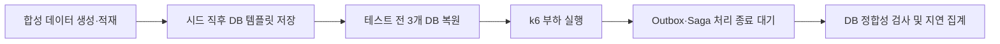
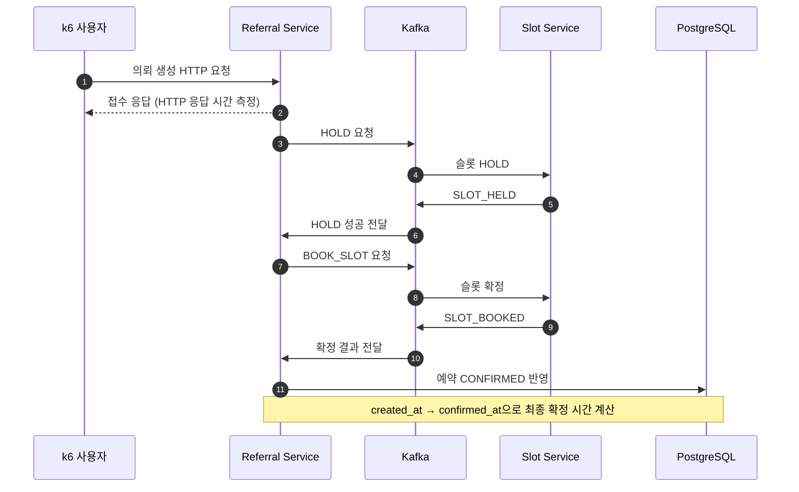

# IT:DA — 부하 테스트 및 성능·정합성 검증

> **의료기관의 실제 업무 패턴을 가정한 합성 데이터 (Synthetic Data)**를 구축하고, AWS EC2 배포 환경에서 예약 Saga의 응답 성능과 동시 요청 시 데이터 정합성을 검증한 기록입니다.
>
> **기준:** 2026-11-18 EC2 배포 환경에서 수행한 가상 사용자 기반 테스트의 **팀 측정 리포트** 및 [테스트 환경 구현 PR #280](https://github.com/HEALO-WORLD/ITDA/pull/280).
> 측정 수치는 팀 측정 리포트 기준입니다. 합격 기준·부하 조건 기본값·Outbox 발행 주기 기본값은 저장소 코드(`load-test/synthetic-data/k6/lib/config.js`, `k6/tests/*.js`, 각 서비스 `application.yml`)에서 확인했습니다.

## 목차

1. [검증 목표와 핵심 결과](#1-검증-목표와-핵심-결과)
2. [테스트 환경 및 데이터 구성](#2-테스트-환경-및-데이터-구성)
3. [판정 기준 및 측정 방법](#3-판정-기준-및-측정-방법)
4. [가상 사용자 기반 테스트 결과](#4-가상-사용자-기반-테스트-결과)
5. [모니터링 구성](#5-모니터링-구성)
6. [동일 슬롯 HOLD 단위 동시성 검증](#6-동일-슬롯-hold-단위-동시성-검증)
7. [AI 활용 — 합성 테스트 데이터 구축](#7-ai-활용--합성-테스트-데이터-구축)
8. [발견 사항과 후속 개선 과제](#8-발견-사항과-후속-개선-과제)
9. [재현 및 검증 방법](#9-재현-및-검증-방법)
10. [참고 자료](#10-참고-자료)

---

## 1. 검증 목표와 핵심 결과

IT:DA의 검사 의뢰는 HTTP 요청이 접수된 뒤 Kafka 이벤트를 통해 슬롯을 `HELD`로 선점하고 `BOOKED`로 확정하는 **비동기 Saga**입니다. 따라서 단순 HTTP 성공뿐 아니라 **예약 최종
확정 시간, 슬롯 중복 점유 여부, 취소와 검사 시작의 상태 경합, 비동기 이벤트 적체**를 분리해 측정했습니다.

### 1.1 검증 항목

| 구분               | 검증 질문                                                                  | 확인 수단                |
|--------------------|----------------------------------------------------------------------------|--------------------------|
| 사용자 업무 기준선 | 일반적인 접수 시간대에 API 응답과 예약 확정이 충분히 빠른가?               | k6, PostgreSQL           |
| 동시성             | 여러 요청이 같은 슬롯이나 예약 상태를 동시에 변경해도 정합성이 유지되는가? | k6, 사후 DB 검증         |
| 스파이크           | 인기 슬롯에 요청이 급증하면 어느 구간에서 지연되고, 얼마나 회복되는가?     | k6, DB 확정 시각, Outbox |
| 스트레스           | 평상시보다 높은 부하에서도 응답 시간 기준을 충족하는가?                    | k6, DB 확정 시각         |
| 운영 관찰          | 내부 이벤트 지연·HTTP 응답·DB 및 JVM 자원 추이를 볼 수 있는가?             | Prometheus, Grafana      |

### 1.2 결과 요약 — EC2 배포 환경

| 테스트                   | 부하 조건                                                 | 핵심 결과                                                            | 판정                                     |
|--------------------------|-----------------------------------------------------------|----------------------------------------------------------------------|------------------------------------------|
| **기준선 (baseline)**    | 08:45~10:00 업무 일정 재생, 원무직원 80명·검사관리자 10명 | 의뢰 생성 p95 **58ms**, 최종 예약 확정 p95 **768ms**                 | **통과** — 로그인 기준을 1초로 분리한 후 |
| **동시성 (concurrency)** | 동일 슬롯 동시 예약 5회차, 취소 vs 검사 시작 30건         | 슬롯당 확정 **1건**, 상태 경합 위반 **0건**                          | **통과**                                 |
| **스파이크 (spike)**     | 10초 이내 인기 슬롯에 400명 집중                          | 급증 구간 확정 p95 **27~43초**, 약 1분 이후 안정 구간 p95 **0.57초** | **기준 미충족** — 회복 구간 판정         |
| **스트레스 (stress)**    | 예약 세션 1→3→5→10건/초, 단계당 2분                       | 10배 단계 의뢰 생성 p95 **264ms**, 확정 p95 **0.98초**               | **통과** — 한계 미도달                   |

**전체 결과:** 제공된 배포 테스트 리포트 기준 4종 테스트의 HTTP 실패는 0건이었으며, **새롭게 발생한 중복 예약·오버부킹은 보고되지 않았습니다.** 다만 스파이크 테스트는 응답·확정 지연 기준을 충족하지
못했습니다. 슬롯 경합으로 의도적으로 실패한 *예약 업무 결과*는 HTTP 실패와 구분해 기록했습니다.

> **정합성 판정 주의:** 사후 비교에서 `BOOKED` 슬롯이지만 확정 예약이 없는 기존 행 **4건**이 모든 회차에 동일하게 나타났습니다. 제공된 리포트는 장비 장애 후 `BLOCKED` 예약을 유지하는
> 설계에서 발생한 **테스트 이전 데이터**로 분류했습니다. 따라서 '모든 DB 비교 항목이 0건'이라고 표현하지 않고, **해당 4건을 제외한 신규 정합성 위반 0건**으로 설명합니다.

## 2. 테스트 환경 및 데이터 구성

### 2.1 실행 환경

| 구분                | 조건                                                                          |
|---------------------|-------------------------------------------------------------------------------|
| 테스트 대상         | **AWS EC2 t4g.large** 단일 인스턴스 (ARM vCPU 2개, 메모리 약 7.6GB)           |
| 애플리케이션        | Gateway, Institution, Slot, Referral Service를 Docker Compose로 실행          |
| 데이터 및 메시징    | PostgreSQL, Apache Kafka, Redis — 동일 EC2에서 실행                           |
| 부하 발생기         | 별도 노트북의 **k6 v1.8.2** → Gateway `:8080`                                 |
| 관찰 도구           | Micrometer, Prometheus, Grafana, PostgreSQL 결과 SQL                          |
| Outbox 발행 주기    | **200ms** (해당 배포 테스트 조건)                                             |
| 합성 데이터 기준일  | **2026-11-18**                                                                |
| 데이터 용량(리포트) | `referral_db` **373MB**, `slot_db` **252MB**                                  |
| 네트워크 참고       | 노트북↔EC2 왕복 약 **30ms**로 보고됨. k6 HTTP 시간에는 네트워크 지연이 포함됨 |

단일 인스턴스에 애플리케이션·DB·Kafka를 함께 배치했기 때문에, 측정값은 이 **특정 자원 구성과 합성 부하 조건**에 한정됩니다.

### 2.2 테스트 데이터 규모

실제 운영 데이터가 없는 상황에서 의료기관 업무 흐름을 기반으로 합성 데이터를 생성했습니다.

| 구분                            |                           데이터 규모 |
|---------------------------------|--------------------------------------:|
| 의뢰기관 담당자                 |                              **80명** |
| 검사기관 및 검사관리자          |                       **10곳 / 10명** |
| 장비                            |                     **25대** (CT·MRI) |
| 협력 관계                       |                             **407건** |
| 가상 사용자 CSV                 |                   **7종, 총 1,012행** |
| 과거 1년치 시드                 |          **20개 테이블, 약 162만 행** |
| 의뢰 / 예약                     |                     각각 **87,600건** |
| 슬롯                            | **176,000건** (과거 1년 및 향후 90일) |
| 검사 / 검사 결과                |               **80,642건 / 74,052건** |
| Outbox 이벤트 (Referral / Slot) |             **172,583건 / 169,140건** |

테스트에서 가정한 주요 사용자 행동은 다음과 같습니다.

- 의뢰기관: 협력기관 조회 → 슬롯 검색 → 의뢰 생성 → 상태 조회, 필요 시 재검색·취소·재예약
- 검사기관: 접수 목록 주기적 조회 → 검사 시작·완료 → 결과 등록
- 시간대: 오픈 직후 30분에 30%, 점심시간 25%, 그 외 시간 45%의 업무 발생을 가정
- 중복 클릭: **같은 멱등성 키**로 의뢰 생성을 재요청하도록 구성
- 추가 행동: 취소 5%, 재예약 10%를 가정

**데이터 검증:** 고정 시드 (20261117)로 생성 결과를 재현하고, 로컬과 EC2에서 20개 테이블의 건수·예약과 슬롯의 연결·슬롯당 활성 예약 수를 확인했습니다. 이 값들은 실측 운영 데이터가 아닌
**테스트 설계 가정**입니다.

### 2.3 회차별 환경 격리

각 부하 테스트를 독립적으로 비교하기 위해 다음 흐름으로 진행했습니다.



- 대상 DB: `institution_db`, `slot_db`, `referral_db`
- **k6 요청 종료 시점**과 **Kafka 비동기 처리 완료 시점**을 구분
- 테스트 종료 후 미발행 Outbox와 진행 중인 예약·HOLD 슬롯을 확인한 다음 정합성 검증
- 확정 예약↔슬롯 연결, 슬롯당/의뢰당 활성 예약, 취소·검사 상태 충돌, DLT 등 **9개 검사 항목** 사용

## 3. 판정 기준 및 측정 방법

### 3.1 합격 기준

| 측정 항목                  | 적용 기준         | 비고                                         |
|----------------------------|-------------------|----------------------------------------------|
| 일반 API 응답 시간         | **p95 500ms**     | API별 지표 사용                              |
| 로그인 API                 | **p95 1초**       | 초기 공통 기준 500ms에서 분석 후 분리한 기준 |
| 예약 생성 → 최종 확정      | **p95 5초**       | DB의 예약 시각 기준                          |
| HTTP 요청 실패             | **0건**           | 예약 업무상 충돌 결과와 구분                 |
| 멱등성·상태 경합·중복 예약 | **신규 위반 0건** | 테스트 후 DB 상태 재검증                     |

> **기준 변경 이력:** 로그인은 기준선에서 p95 616ms를 기록해 최초 공통 기준 500ms를 넘었습니다. BCrypt 검증 비용과 동시 로그인 조건을 분석한 뒤 로그인 기준을 **1초로 별도 설정**
> 했습니다. 따라서 '최초 정의한 모든 기준을 통과'한 것은 아닙니다.

### 3.2 HTTP 응답과 최종 예약 확정의 차이



- **HTTP 응답 시간:** k6에서 측정하며 네트워크 왕복 시간도 포함됩니다.
- **Saga 최종 확정 시간:** `confirmed_at - created_at`을 PostgreSQL에서 밀리초 단위로 집계합니다.
- **k6 상태 조회:** 1초 간격으로 상태를 확인하므로, 조회 기반 확정 시간만으로 세밀한 밀리초 차이를 판단하지 않습니다.
- **정합성 결과:** HTTP 응답·예약 상태·슬롯 상태를 함께 확인해야 합니다.

## 4. 가상 사용자 기반 테스트 결과

### 4.1 기준선 (Baseline)

**목적:** 접수 오픈 시간대를 포함한 **08:45~10:00** 의료기관 담당자의 실제 업무 일정을 가정한 속도로 재생합니다.

**결과:** HTTP 요청 **2,126건**, HTTP 실패 **0건**. 의뢰 생성 p95는 **58ms**, 최종 예약 확정 p95는 **768ms**(최대 825ms)였습니다.

| API                 |   p95 | 중앙값 | 적용 기준 | 결과                |
|---------------------|------:|-------:|----------:|---------------------|
| 로그인              | 616ms |  113ms |   1,000ms | 통과 (기준 분리 후) |
| 검사 목록(검사기관) |  85ms |   57ms |     500ms | 통과                |
| 슬롯 조회           |  69ms |   41ms |     500ms | 통과                |
| 의뢰 생성           |  58ms |   39ms |     500ms | 통과                |
| 검사 시작           |  22ms |   13ms |     500ms | 통과                |
| 취소                |  21ms |   17ms |     500ms | 통과                |
| 결과 등록           |  20ms |   13ms |     500ms | 통과                |
| 검사 완료           |  19ms |   10ms |     500ms | 통과                |
| 토큰 재발급         |  19ms |   11ms |     500ms | 통과                |
| 의뢰 조회           |  16ms |    8ms |     500ms | 통과                |
| 협력 기관 목록      |  15ms |   10ms |     500ms | 통과                |

- 예약 상태: **확정 73건, 취소 5건, 실패 2건**. 실패 2건은 동일 슬롯 경합으로 보고되었습니다.
- 검사기관 담당자: 당일 검사 **25건** 완료 처리
- 접수 오픈 시각 (09:00) 1분에 예약 **16건**이 몰린 구간의 확정 p95는 **562ms**

**해석:** 가정한 평상시 업무 시간대에서는 예약 처리 지연이 목표 이내였으며, 로그인은 공통 API 기준과 분리해 관리할 필요가 있었습니다.

### 4.2 동시성 (Concurrency)

**목적:** 같은 슬롯 예약 요청과 동일 예약의 취소·검사 시작 요청이 동시에 발생했을 때 **한쪽만 유효하게 처리되는지** 검증합니다.

**결과:** 전체 HTTP 요청 **1,054건**, HTTP 실패 **0건**, 보고된 상태 경합 위반 **0건**.

| 시나리오               | 실행 조건                                       | 측정 결과                                                    |
|------------------------|-------------------------------------------------|--------------------------------------------------------------|
| 동일 슬롯 동시 예약    | 같은 슬롯에 다수 의뢰를 보내는 테스트 **5회차** | 각 회차 **정확히 1건** 확정, 나머지 충돌 실패 **총 155건**(팀 측정 리포트 기준, 실제 실행 설정 추가 확인 필요) |
| 같은 멱등 키 중복 요청 | 동일 키로 동시 의뢰 요청                        | 멱등성 위반 **0건** (개별 요청 수는 리포트에 없음)           |
| 취소 vs 검사 시작      | 동일 예약을 대상으로 **30건**의 경합            | **취소 성공 27건 / 검사 시작 성공 3건**, 모순된 상태 **0건** |

**사후 확인:** 슬롯 또는 의뢰에 활성 예약이 중복 생성되지 않았고, 취소된 의뢰가 검사 진행 상태로 바뀐 사례도 보고되지 않았습니다.

> 이 테스트는 **API를 통한 업무 흐름 전체**의 정합성 검증입니다. JUnit의 슬롯 HOLD 단위 동시성 테스트 결과는 [6장](#6-동일-슬롯-hold-단위-동시성-검증)에서 별도로 구분합니다.

### 4.3 스파이크 (Spike)

**목적:** 정상 부하 도중 **10초 안에 사용자 400명**이 인기 슬롯에 집중할 때 요청 지연과 사후 회복을 확인합니다.

**판정:** **기준 미충족 (회복 구간)**. HTTP 실패나 오버부킹이 없더라도 응답·예약 확정 지연이 합격 기준을 초과했습니다.

| 항목                                    |                    측정 결과 |
|-----------------------------------------|-----------------------------:|
| HTTP 요청                               |                  **7,300건** |
| HTTP 실패                               |                      **0건** |
| 슬롯 경합으로 인한 예약 실패            | **372건** — 의도된 경합 결과 |
| 급증 구간 예약 확정 p95                 |                  **27~43초** |
| 회복 구간 k6 의뢰 생성 p95              |                   **4.26초** |
| 회복 구간 k6 검사 목록 p95              |                   **5.28초** |
| 회복 구간 k6 예약 확정 p95              |                   **17.4초** |
| 급증 이후 약 1분이 지난 구간의 확정 p95 |                   **0.57초** |
| Referral Outbox 적체 해소까지           |                   **약 1분** |

**해석 및 한계**

- 설정된 `base_after` 회복 구간은 **급증 시작 시점과 동시에 시작**해 첫 1분의 지연까지 포함합니다. 따라서 회복 구간 전체 p95는 기준을 넘었고 테스트 판정도 실패였습니다.
- 반면 제공된 리포트의 **급증 약 1분 이후** 세부 시간 구간에서는 p95가 **0.57초**로 돌아왔다고 기록되어 있습니다. 두 수치는 **집계 시간 범위가 달라** 동시에 성립할 수 있습니다.
- 주된 지연 후보로 **Referral Outbox 적체**가 보고되었습니다. 추후 Grafana와 Outbox 미발행 건수 시계열을 회차별로 묶어 확인할 필요가 있습니다.
- 원본 리포트의 그래프는 별도 임베드 참조 (`[embed: node/2fc17620-f310]`)로 제공되어 **PNG 원본이 확보되지 않았습니다.** 따라서 여기에는 실제 그래프를 만들어 넣지 않았습니다.

### 4.4 스트레스 (Stress)

**목적:** 예약 세션 도착률을 **1 → 3 → 5 → 10건/초**로 높이며 응답 시간과 최종 확정 지연을 확인합니다 (각 단계 2분).

**결과:** 리포트 기준 **10분 동안 예약 2,336건 생성, 2,327건 확정, 9건은 슬롯 경합으로 실패**했습니다. HTTP 실패는 0건이었습니다.

| 항목               |    10배 단계 결과 |  기준 | 판정 |
|--------------------|------------------:|------:|------|
| 의뢰 생성 p95      |         **264ms** | 500ms | 통과 |
| 예약 최종 확정 p95 |        **0.98초** |   5초 | 통과 |
| HTTP 실패          |           **0건** |   0건 | 통과 |
| 중복 예약·오버부킹 | **신규 위반 0건** |   0건 | 통과 |

**해석:** 평상시 기준 약 10배 부하까지 성능·정합성 기준을 충족했지만, **상한을 초과하지 않았으므로 이 서버의 최대 처리 용량을 확인한 실험은 아닙니다.** 20배·30배 부하에서 한계가 나타나는지는 추가
측정이 필요합니다.

> 원본 리포트의 스트레스 그래프 역시 별도 임베드 (`[embed: node/8933aac3-506b]`)로 제공되어 PNG 없이 수치만 기록했습니다.

## 5. 모니터링 구성

EC2의 Prometheus는 Spring Boot Actuator의 `/actuator/prometheus`를 **15초 간격**으로 수집하며, Grafana에는 다음 대시보드를 설정했습니다.

| 대시보드                  | 확인 항목                                                   |
|---------------------------|-------------------------------------------------------------|
| `ITDA`                    | HTTP 요청량·5xx·평균 지연, Kafka 처리량, HikariCP, JVM 지표 |
| `ITDA · Slot 도메인`      | HOLD·BookSlot 결과, 이벤트 체류 시간, Outbox 발행 대기      |
| `ITDA · Slot 부하 테스트` | 입력·출력 처리량, Kafka Consumer Lag, DB Pending 및 GC      |

측정 구간을 해석할 때는 아래 네 가지 시간을 구분합니다. 지표를 조회하는 PromQL은 [9.3](#93-grafana에서-확인할-지표)에 있습니다.

| 구분 | 측정 위치 | 주요 지표 |
|---|---|---|
| HTTP 응답 시간 | k6 (네트워크 왕복 포함) | `http_req_duration`, `http_req_failed` |
| 예약 최종 확정 시간 | PostgreSQL | `confirmed_at - created_at` (`after-test.sh`) |
| Slot 명령 처리·이벤트 체류 | Slot Service (Micrometer) | `slot_command_duration_seconds`, `slot_event_dwell_seconds` |
| Outbox 발행 대기 | Referral·Slot Service (Micrometer) | `outbox_publish_wait_seconds` |

이 밖에 Kafka 적체는 `kafka_consumer_fetch_manager_records_lag`, DB 커넥션은 `hikaricp_connections_active`·`hikaricp_connections_pending`으로 확인합니다.

## 6. 동일 슬롯 HOLD 단위 동시성 검증

가상 사용자 기반 테스트와 별도로, **JUnit + Testcontainers + PostgreSQL 18** 환경에서 동일 슬롯에 대한 선점 구현을 비교했습니다.

**개선 방식:** 슬롯 상태가 `AVAILABLE`인 경우에만 성공하도록 `UPDATE ... WHERE status = 'AVAILABLE'` 조건부 갱신을 적용했습니다. PostgreSQL은 경합하는 행 갱신
시 상태 조건을 다시 확인하므로, 동일 슬롯에 대한 후속 요청은 성공하지 못합니다.

### 6.1 적용 전후 측정

측정 조건: HikariCP `maximumPoolSize=10`, 워밍업 1회, 각 조건 10회 반복. 아래
수치는 [동시성 제어 PR #40](https://github.com/HEALO-WORLD/ITDA/pull/40)에 기록된 값입니다.

| 방식              | 동시 스레드 | 선점 성공 평균 / 최대 |  예외 | 평균 소요 시간 |
|-------------------|------------:|----------------------:|------:|---------------:|
| 기존 조회 후 갱신 |          10 |             10.0 / 10 |     0 |        115.8ms |
| 기존 조회 후 갱신 |          50 |             10.0 / 10 |     0 |        263.9ms |
| 기존 조회 후 갱신 |         100 |             10.0 / 10 |     0 |        231.0ms |
| **조건부 UPDATE** |      **10** |           **1.0 / 1** | **0** |    **230.5ms** |
| **조건부 UPDATE** |      **50** |           **1.0 / 1** | **0** |    **370.6ms** |
| **조건부 UPDATE** |     **100** |           **1.0 / 1** | **0** |    **530.6ms** |

**결과:** 검증 조건에서 동일 슬롯의 선점 성공을 1건으로 제한하고 중복 선점을 방지했습니다. 정합성 확보 대신 평균 처리 시간은 증가했으며, 이 결과를 서로 다른 슬롯 간 처리량으로 일반화할 수는 없습니다.

### 6.2 회귀 검증

`SlotHoldConcurrencyTest`는 10·50·100스레드에 대해 **선점 성공 1건 / 나머지 거절 / 예외 0건**을 검증합니다. 이는 별도로 수행한 **로컬 서비스·DB 단위 테스트**로, 4장의
EC2 API 동시성 테스트와 구분해야 합니다.

## 7. AI 활용 — 합성 테스트 데이터 구축

### 7.1 배경 및 문제 해결

서비스가 운영 전이어서 실사용자 호출량과 과거 예약 데이터가 없었습니다. 팀은 AI를 활용해 의료기관 담당자의 행동 시나리오와 생성기 초안을 구체화했습니다. 이를 **실제 API·도메인 제약과 대조해 수정한 뒤, 반복 가능한 테스트 환경**으로 구축했습니다.

| 구분               | 기존 상태             | 구축 후                                 | 검증                              |
|--------------------|-----------------------|-----------------------------------------|-----------------------------------|
| 가상 사용자 데이터 | 업무 흐름 가정만 존재 | **CSV 7종, 1,012행**                    | 고정 시드로 재생성 가능           |
| 대규모 DB 시드     | 적재 데이터 없음      | **20개 테이블 약 162만 행** (의뢰·예약 각 87,600건, 슬롯 176,000건 포함) | 로컬·EC2 적재 및 건수·정합성 확인 |
| 실행·복원 방식     | 개별 수동 작업        | 생성·적재·검증·템플릿 복원 스크립트     | 회차별 초기 조건 통일             |
| 부하 시나리오      | 제한적인 요청 위주    | baseline / concurrency / spike / stress | 주요 업무 경로별 부하 측정        |

### 7.2 AI 활용 범위와 팀의 검증

- **시나리오 설계 지원 (AI 활용):** 가상 사용자 행동 시나리오와 사용 패턴 가정을 구체화하고, 불일치·개선안을 제시
- **API·도메인 제약 대조:** 가정한 행동을 실제 API와 엔티티 제약에 맞춰 검토하고 수정
- **생성기·스크립트 구축:** `gen_users.py`·`gen_seed.py`, 적재·복원 스크립트, k6 시나리오를 작성. AI가 만든 초안은 팀이 검토한 뒤 반영
- **팀의 의사결정:** 트래픽 규모와 업무 흐름의 현실성 판단, 같은 멱등성 키 중복 요청 규칙, 오픈 시간대 30%·점심 25% 분포, 취소 5%·재예약 10% 조건 확정
- **로컬·EC2 검증:** 데이터 적재, 테이블별 건수 확인, 확정 예약↔슬롯 연결 및 슬롯당 활성 예약 조건 검증

이 과정을 통해 실데이터 없이도 **회차마다 같은 초기 조건에서 반복할 수 있는 성능·정합성 검증 환경**을 팀 차원에서 갖췄고, 4장의 EC2 부하 테스트를 수행했습니다.

가상 사용자 CSV에는 `referrer_sessions.csv`(240행), `today_examinations.csv`(240행), `partnerships.csv`(407행),
`referrer_users.csv`(80행), `equipments.csv`(25행), `lab_managers.csv`(10행), `labs.csv`(10행)가 포함됩니다.

**한계:** 사용자 행동 시간 분포·취소율 등은 가정값이므로 실제 운영 트래픽을 대표한다고 단정하지 않습니다. 대규모 한 가지 데이터 세트만 구축했고, 데이터 생성 소요 시간은 별도로 측정하지 않았습니다.

**구현 근거:** [합성 데이터 및 k6 시나리오 구축 PR #280](https://github.com/HEALO-WORLD/ITDA/pull/280)

## 8. 발견 사항과 후속 개선 과제

### 8.1 로그인 동시 요청 지연

BCrypt (강도 10) 기반 비밀번호 확인의 CPU 비용으로 인해 로그인 요청이 몰릴수록 지연이 늘어났습니다. 제공된 리포트의 별도 측정 결과는 다음과 같습니다.

| 로그인 조건 (노트북 → EC2) | 중앙값 |   최대 |
|----------------------------|-------:|-------:|
| 순차 5건                   |  132ms |  139ms |
| 동시 10건                  |  464ms |  512ms |
| 동시 28건                  | 1.54초 | 1.81초 |

접수 오픈 1분 동안 약 28명이 로그인한 기준선에서는 로그인 p95가 616ms였습니다. 비밀번호 검증 강도는 변경하지 않았으며, 로그인 기준을 별도로 1초로 정의했습니다. 동시 로그인 사용자가 늘 경우
Institution Service의 CPU 여유와 수평 확장 가능성을 추가 검토해야 합니다.

### 8.2 Outbox 발행 주기와 Saga 확정 지연

- **이전 로컬 측정:** Outbox 발행 주기 **1초**, 기준선 예약 확정 p95 **2.7초**
- **EC2 배포 측정:** Outbox 발행 주기 **200ms**, 기준선 예약 확정 p95 **768ms**
- **관찰된 한계:** 스파이크 상황의 Referral Outbox 적체로 예약 확정이 최대 수십 초까지 늦어졌고, 적체 해소에 약 1분 소요

발행 주기를 짧게 하면서 처리 지연이 감소하는 방향을 관찰했지만, **로컬과 EC2의 실행 환경이 서로 다르므로 2.7초 → 768ms의 차이를 발행 주기 변경만의 효과로 단정할 수는 없습니다.** 환경을 통제한
A/B 실험이 추가로 필요합니다.

### 8.3 남은 과제

1. **스파이크 회복 기준 개선:** 급증 시작과 회복 측정 시작을 분리해, 급증 종료 **60초 이후 구간**의 회복 지표를 별도로 판정
2. **처리량 한계 탐색:** EC2 환경에서 평시 **20배·30배** 등 높은 단계 추가 실행
3. **Referral Outbox 분석:** 발행 대기열 증가·소진 속도를 Grafana와 DB 상태로 대조
4. **내구성 시험:** 장시간 부하를 유지하는 soak 테스트는 이번 결과에서 제외됐으므로 별도 수행
5. **데이터 정리:** 테스트 종료 후 합성 시드·DB 템플릿을 팀 합의하에 제거하고 운영 상태 검증
6. **원본 결과 보존:** 회차별 `results/*.json`·`.log`, `after-test.sh` 출력, 실행 시작·종료 시각, 배포 커밋 SHA를 함께 보관. 실행 시간대의 Grafana 화면(Consumer Lag·HikariCP Pending·Outbox 대기)도 남겨 리포트 수치를 원본과 대조할 수 있게 함
7. **동시성 충돌 건수 대조:** 4.2의 충돌 실패 155건(팀 측정 리포트)과 테스트 코드 기본값(30 VU × 5회차) 기준 145건의 차이를 실행 설정·로그로 확인

## 9. 재현 및 검증 방법

> **실행 주의:** 아래 명령은 테스트 DB를 복원하거나 데이터를 생성·삭제할 수 있습니다. 공유 EC2에서는 다른 팀원의 작업과 충돌할 수 있으므로, **백업·테스트 계정·대상 서버·DB 초기화 범위**를
> 확인한 다음 실행해야 합니다. `run-seed.sh`는 저장소 코드 기준 **로컬 Docker PostgreSQL 전용**이며, 운영 DB에 무심코 실행하면 안 됩니다.

### 9.1 합성 데이터 생성·적재 (로컬 예시)

```bash
cd load-test/synthetic-data

# 가상 사용자 CSV 생성 및 시드 생성·적재·검증
python gen_users.py
./run-seed.sh --today 2026-11-18

# 생성된 데이터를 검증하고 시드 템플릿 저장
./run-seed.sh verify
./reset-db.sh snapshot
```

### 9.2 테스트 실행 및 사후 정합성 검증

```bash
cd load-test/synthetic-data

# 각 회차 전 — 복원하면 현재 DB 데이터가 바뀌므로 대상 확인 필수
./reset-db.sh restore

# 테스트 종류별 하나만 선택해 실행
./run-k6.sh baseline
# ./run-k6.sh concurrency
# ./run-k6.sh spike
# ./run-k6.sh stress -e LEVELS=1,3,5,10 -e STAGE_MIN=2

# Outbox·Saga 후속 처리 대기 및 정합성 검사
./after-test.sh
```

- `run-k6.sh`는 실행 결과를 `results/<테스트>-<시각>.json` 및 `.log`로 저장합니다.
- `after-test.sh`는 비동기 이벤트 소진 여부를 기다리고 DB 정합성 및 1분 단위 확정 시간을 출력합니다.

> 2026년 11월 18일 테스트 수치는 팀 측정 리포트를 기준으로 작성했으며, 회차별 원본 JSON·로그는 확보하지 못했습니다. 재현 명령은 저장소의 테스트 스크립트를 기준으로 제공합니다. 위 명령은 재현용 예시이며, 문서의 수치를 다시 측정했다는 뜻은 아닙니다.

### 9.3 Grafana에서 확인할 지표

```promql
# 슬롯 HOLD 결과의 초당 처리량
sum by (result) (rate(slot_hold_total{application="slot-service"}[1m]))
```

```promql
# 슬롯 이벤트 체류 시간 p95 (이벤트 생성 → 결과 발행)
histogram_quantile(
  0.95,
  sum by (le) (
    rate(slot_event_dwell_seconds_bucket{application="slot-service"}[5m])
  )
)
```

```promql
# DB 커넥션 대기
sum(hikaricp_connections_pending{application="referral-service"})
```

> Prometheus 메트릭은 모니터링용 지표이며, **정확한 최종 예약 확정 건수·시간은 DB 및 실행 로그**와 함께 대조합니다.

## 10. 참고 자료

### 프로젝트 코드 및 PR

- [가상 사용자·시드·k6 테스트 환경 구축 — PR #280](https://github.com/HEALO-WORLD/ITDA/pull/280)
- [동일 슬롯 HOLD 조건부 UPDATE 개선 및 성능 측정 — PR #40](https://github.com/HEALO-WORLD/ITDA/pull/40)
- [Synthetic Data 생성기 및 스크립트](https://github.com/HEALO-WORLD/ITDA/tree/main/load-test/synthetic-data)
- [가상 사용자 기반 k6 테스트 코드](https://github.com/HEALO-WORLD/ITDA/tree/main/load-test/synthetic-data/k6/tests)
- [PostgreSQL 사후 정합성 검사](https://github.com/HEALO-WORLD/ITDA/blob/main/load-test/synthetic-data/after-test.sh)
- [Grafana 대시보드 구성](https://github.com/HEALO-WORLD/ITDA/tree/main/docker/grafana/provisioning/dashboards/json)
- [Prometheus 수집 설정](https://github.com/HEALO-WORLD/ITDA/blob/main/docker/prometheus/prometheus.app.yml)

### 공식 기술 문서

- [Grafana k6 — Thresholds](https://grafana.com/docs/k6/latest/using-k6/thresholds/)
- [Grafana k6 — Arrival-rate executors](https://grafana.com/docs/k6/latest/using-k6/scenarios/executors/)
- [Prometheus — Query functions](https://prometheus.io/docs/prometheus/latest/querying/functions/)
- [PostgreSQL — Aggregate functions (`percentile_cont`)](https://www.postgresql.org/docs/current/functions-aggregate.html)

---

**종합:** 가정한 평상시 업무 흐름 및 평시 10배 부하에서는 설정한 응답 시간·정합성 기준을 충족했습니다. 동시에 같은 슬롯·상태를 변경하는 요청에도 신규 중복 예약이나 상태 경합 위반은 확인되지 않았습니다.
반면 급격한 인기 슬롯 요청에는 **Referral Outbox 적체와 확정 지연**이 나타나 스파이크의 회복 구간 기준을 넘었습니다. 이 결과는 시스템의 안정적인 범위와 추가 개선이 필요한 범위를 구분해
보여줍니다.
