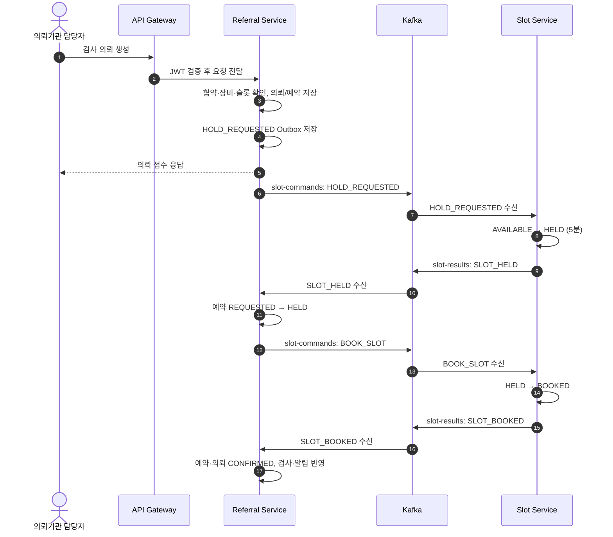
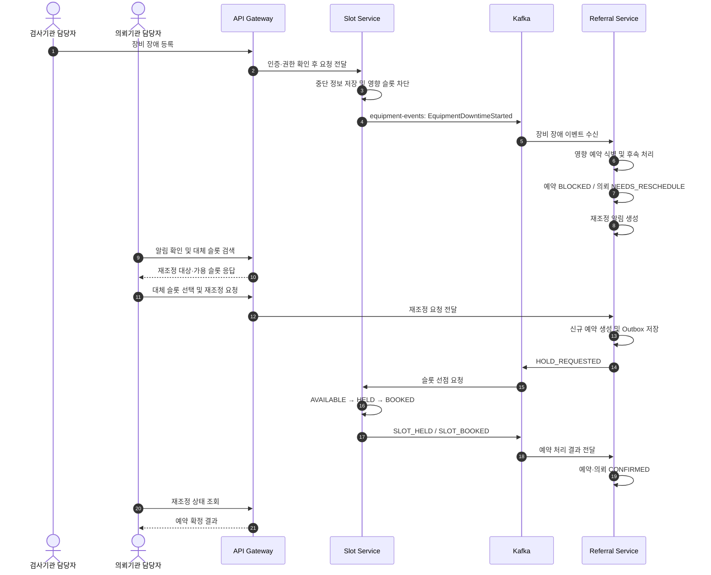
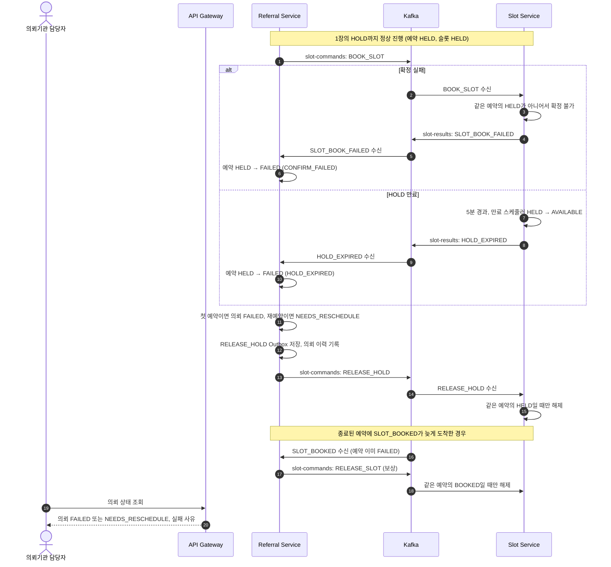
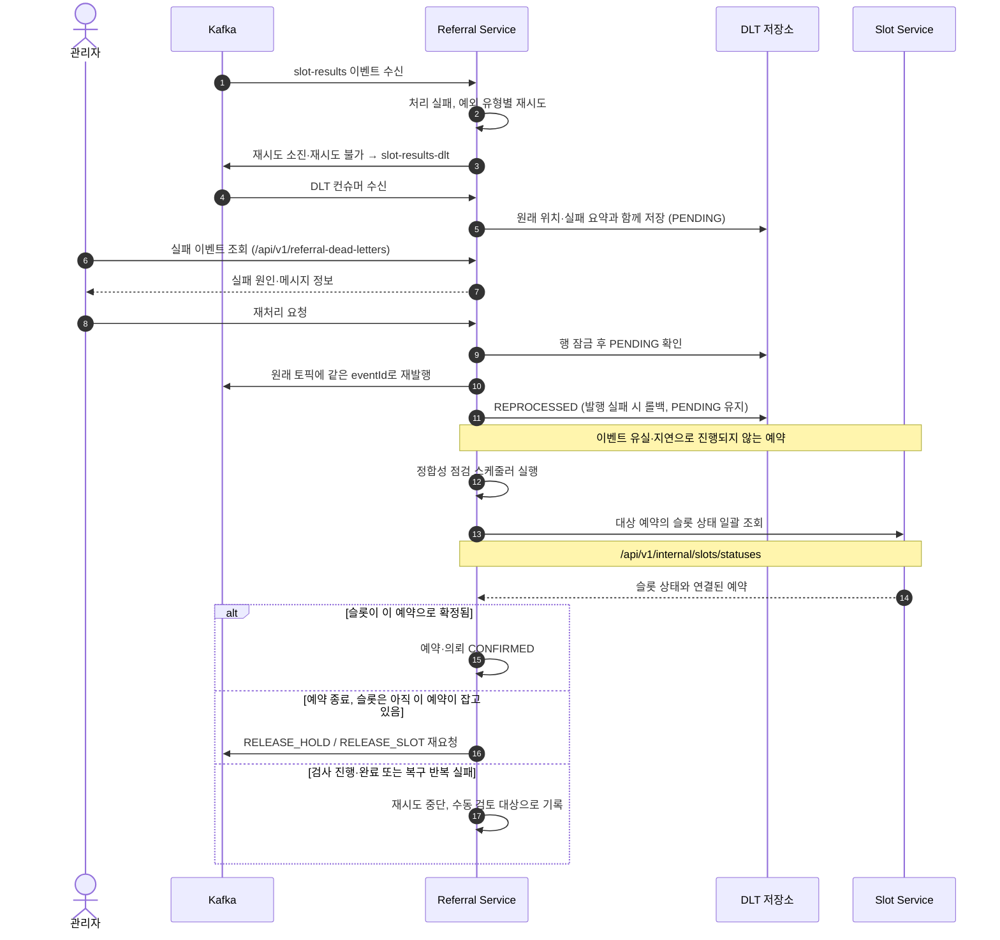
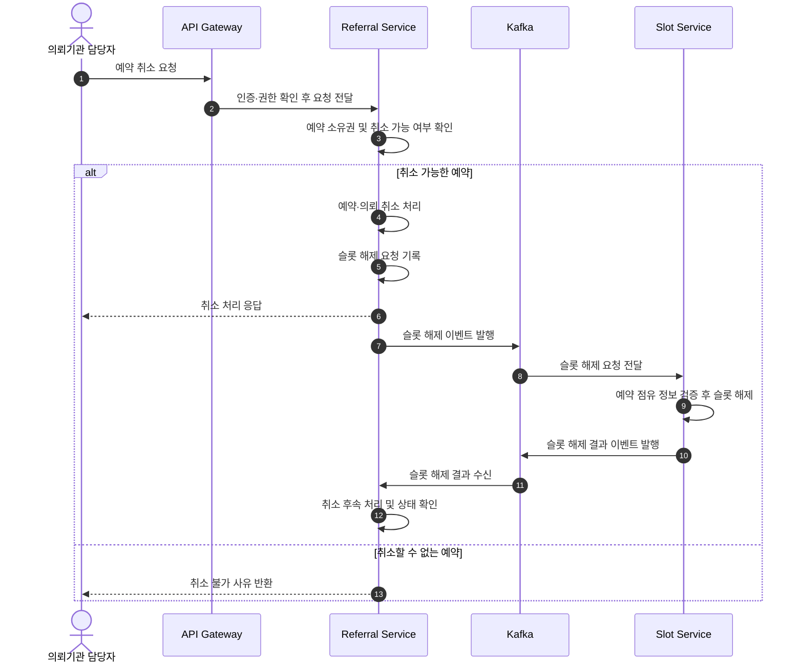
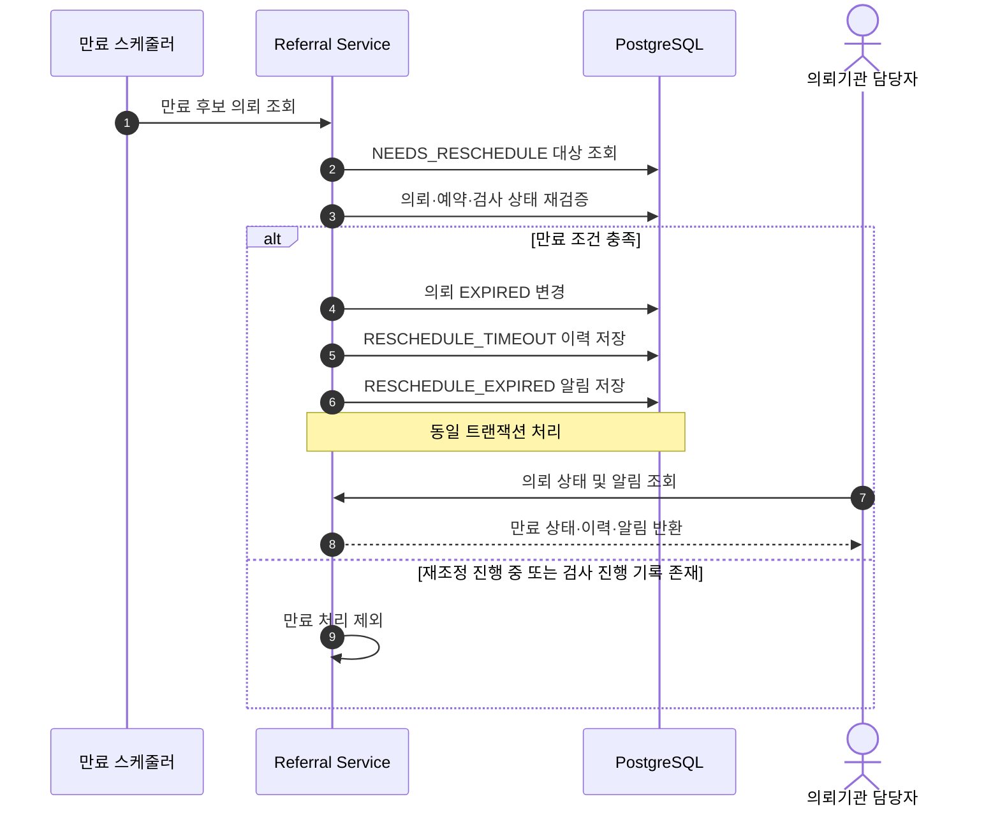

# IT:DA 상세 업무 시나리오

의료기관 간 검사 의뢰 및 예약 과정에서 발생하는 정상 처리, 장비 장애, 예약 실패, 이벤트 처리 실패 및 복구 흐름을 정리한 문서입니다.

IT:DA는 서비스 간 데이터 정합성이 중요한 예약 처리에 Kafka 기반 비동기 이벤트와 Saga 보상 패턴을 적용하고, 장애 상황에서도 예약 상태의 일관성을 유지하도록 구성했습니다.

## 목차

1. [정상 의뢰 및 예약 확정](#1-정상-의뢰-및-예약-확정)
2. [장비 장애 및 예약 재조정](#2-장비-장애-및-예약-재조정)
3. [예약 확정 실패와 Saga 보상](#3-예약-확정-실패와-saga-보상)
4. [이벤트 처리 실패와 정합성 복구](#4-이벤트-처리-실패와-정합성-복구)
5. [예약 취소 및 슬롯 반환](#5-예약-취소-및-슬롯-반환)

---

## 1. 정상 의뢰 및 예약 확정

### 시나리오 개요

의뢰기관에서 검사 의뢰를 생성하면 Referral Service가 의뢰 및 예약 정보를 저장하고, Kafka 이벤트를 통해 Slot Service에 슬롯 선점을 요청합니다.

Slot Service는 슬롯을 임시 선점 (HOLD)한 뒤 예약 확정을 진행하며, 처리 결과를 Referral Service에 전달합니다.

### 처리 흐름

### 주요 처리 정책

- 의뢰 생성 API의 성공 응답은 최종 예약 확정을 의미하지 않으며, Kafka 이벤트를 통한 비동기 처리 결과에 따라 최종 상태가 결정됩니다.
- 같은 멱등키로 다시 요청하면 기존 의뢰를 그대로 반환하고, 같은 키에 다른 내용이 오면 거절합니다.
- 같은 슬롯의 명령과 결과는 메시지 키 `slotId`를 사용하여 각각의 토픽 내 동일 파티션에서 순서대로 처리됩니다.
- 중복 수신된 이벤트는 처리 완료 기록과 조건부 UPDATE를 통해 한 번만 반영됩니다.

### 성공 기준

- 의뢰 및 예약 상태가 `CONFIRMED`로 변경됩니다.
- 슬롯 상태가 `BOOKED`로 변경됩니다.
- 동일 슬롯에 중복 예약이 발생하지 않습니다.
- Kafka 이벤트 중복 수신 시에도 최종 예약 상태가 중복 변경되지 않습니다.

---

## 2. 장비 장애 및 예약 재조정

### 시나리오 개요

검사기관에서 장비 중단을 등록하면 Slot Service가 장애 시간대의 슬롯을 차단하고, Kafka 이벤트를 통해 Referral Service가 영향받는 예약을 식별합니다.

의뢰기관은 재조정 알림을 확인하고 대체 슬롯을 선택하여 기존 의뢰에 대한 새로운 예약을 진행할 수 있습니다.

### 처리 흐름

### 주요 처리 정책

- 재조정이 필요한 의뢰는 `NEEDS_RESCHEDULE` 상태로 관리합니다.
- 의뢰기관 담당자는 대체 슬롯을 선택해 새로운 예약 시도를 진행합니다.
- 장애 기간의 빈 슬롯만 `UNAVAILABLE`로 막고, 이미 `HELD`·`BOOKED`인 슬롯은 장애 표시를 남긴 뒤 후속 처리로 정리합니다.
- 영향 예약은 작업 단위로 스케줄러가 처리하여, 일부 처리가 실패해도 해당 건만 다시 시도하고 진행 상황을 추적할 수 있습니다.
- 재조정은 시도 번호 (`attemptNo`)를 올린 새 예약으로 진행하며, 기존 검사 기록은 새 예약에 다시 연결되어 중복 생성되지 않습니다.
- 재조정 중 슬롯 선점에 실패하면 의뢰는 `NEEDS_RESCHEDULE`로 남아 다른 슬롯을 다시 선택할 수 있습니다.
- 장비 복구 후에는 예약이 연결되지 않은 미래 슬롯만 재개방합니다.

### 성공 기준

- 장애 시간대의 신규 예약 가능 슬롯이 차단됩니다.
- 영향받은 예약이 `BLOCKED` 상태로 변경됩니다.
- 의뢰 상태가 `NEEDS_RESCHEDULE`로 변경됩니다.
- 의뢰기관이 재조정 필요 알림을 확인할 수 있습니다.
- 대체 슬롯 예약 성공 시 신규 예약 및 의뢰 상태가 `CONFIRMED`로 변경됩니다.
- 이전 예약 및 새로운 예약의 상태와 검사 기록 간 정합성이 유지됩니다.

---

## 3. 예약 확정 실패와 Saga 보상

### 시나리오 개요

슬롯 선점 (HOLD) 이후 예약 확정이 실패하거나 HOLD가 만료되면, Referral Service가 예약을 실패 처리하고 이미 잡힌 슬롯을 해제하는 보상 명령을 발행합니다.

비동기 환경에서 뒤늦게 도착한 예약 확정 이벤트도 처리하여, 종료된 예약으로 인해 슬롯이 불필요하게 점유되지 않도록 관리합니다.

### 처리 흐름

### 주요 처리 정책

- 예약 실패 처리는 `HELD` 상태일 때만 변경하는 조건부 UPDATE로 수행합니다.
- 같은 실패 이벤트가 중복으로 수신되거나 다른 결과가 먼저 반영된 경우, 기존 상태를 다시 변경하지 않습니다.
- 보상 명령 (`RELEASE_HOLD`, `RELEASE_SLOT`)은 Outbox에 저장하여 후속 발행을 관리합니다.
- Slot Service는 해당 예약이 점유한 슬롯에 대해서만 해제를 수행하여 다른 예약의 슬롯을 해제하지 않습니다.
- 실패 이후 늦게 도착한 확정 결과는 예약을 되살리지 않고, 슬롯 해제를 요청합니다.
- 첫 예약 실패 시에는 의뢰를 `FAILED`로 처리하고, 재예약 실패 시에는 `NEEDS_RESCHEDULE` 상태를 유지합니다.

### 성공 기준

- 예약 확정 실패 시 예약이 `FAILED`로 변경됩니다.
- 첫 예약 실패와 재예약 실패가 서로 다른 의뢰 상태로 반영됩니다.
- 슬롯 선점이 남아 있는 경우 보상 명령을 통해 해제됩니다.
- 동일 보상 이벤트가 반복 처리되어도 다른 예약의 슬롯에 영향을 주지 않습니다.
- 이미 종료된 예약에 확정 이벤트가 늦게 도착해도 예약이 잘못 확정되지 않습니다.

---

## 4. 이벤트 처리 실패와 정합성 복구

### 시나리오 개요

Kafka 이벤트 처리에 실패하면 오류 유형에 따라 재시도한 뒤 DLT (Dead Letter Topic)에 저장하고, 관리자가 실패 이벤트를 조회하여 재처리할 수 있도록 구성했습니다.

또한 이벤트 유실이나 지연으로 예약 처리가 중간 상태에 머무는 경우, 정합성 점검 스케줄러가 실제 슬롯 상태와 예약 상태를 비교하여 복구를 시도합니다.

### 처리 흐름

### 주요 처리 정책

- 재시도해도 해결되지 않는 오류는 DLT로 보내고, DLT 메시지는 자동 재발행하지 않고 저장하여 관리자가 재처리하거나 무시할 수 있도록 합니다.
- 재처리는 행 잠금을 사용해 동시 요청 중 한 건만 발행하도록 제어합니다.
- 동일한 `eventId`를 사용하여 이미 처리한 이벤트가 중복 반영되지 않도록 합니다.
- 정합성 점검은 이벤트 전달 여부만 확인하는 것이 아니라 예약과 슬롯의 실제 상태를 비교합니다.
- 슬롯이 해당 예약으로 확정된 경우 예약 및 의뢰 상태를 반영하고, 종료된 예약이 슬롯을 점유한 경우 해제를 재요청합니다.
- 검사가 시작된 예약이나 자동 복구를 반복적으로 실패한 건은 수동 검토 대상으로 기록합니다.

### 성공 기준

- 처리 실패 이벤트가 재시도 정책에 따라 처리됩니다.
- 재시도에 실패한 이벤트가 DLT에 전달되고 관리 대상에 기록됩니다.
- 관리자가 실패 이벤트를 조회하고 재처리할 수 있습니다.
- 동일 이벤트의 중복 재처리 시에도 예약 상태가 중복 변경되지 않습니다.
- 정합성 점검을 통해 예약과 슬롯 상태의 불일치를 식별하고 복구를 시도합니다.
- 자동 복구가 부적절한 건은 수동 검토 대상으로 분류됩니다.

---

## 5. 예약 취소 및 슬롯 반환

> 이 장은 예약 취소 기능의 일반적인 설계 흐름을 바탕으로 작성했습니다. 실제 구현의 취소 가능 조건, 상태 전이, Kafka 이벤트 명칭과 처리 순서는 코드 확인 후 확정해야 합니다.

### 시나리오 개요

의뢰기관 담당자가 확정된 예약의 취소를 요청하면, Referral Service는 취소 가능 여부를 검증하고 예약 및 의뢰의 취소 처리를 진행합니다.

예약이 점유하던 슬롯은 Slot Service에서 해제하며, 이후 다른 의뢰기관에서 해당 슬롯을 다시 예약할 수 있도록 관리하는 것을 목표로 합니다.

### 처리 흐름

### 주요 검토 정책

- 예약 취소 요청 시 해당 기관의 예약인지 소유권을 검증해야 합니다.
- 검사가 이미 시작되었거나 완료된 예약 등 취소할 수 없는 상태에 대한 정책이 필요합니다.
- 예약 취소와 슬롯 해제는 서로 다른 서비스에서 처리되므로, 중간 실패에 대한 후속 처리 정책이 필요합니다.
- 동일 예약의 중복 취소 요청이 들어와도 결과가 일관되도록 멱등성을 보장해야 합니다.
- 슬롯 해제 시 해당 예약이 실제로 점유한 슬롯인지 확인하여 다른 예약에 영향을 주지 않아야 합니다.
- 해제 실패나 이벤트 지연이 발생하면 재시도 또는 정합성 점검을 통해 후속 처리할 수 있어야 합니다.

### 성공 기준

- 취소 가능 조건을 만족하는 예약만 취소 처리됩니다.
- 취소된 예약이 점유하던 슬롯이 적절히 반환됩니다.
- 중복 취소 요청으로 인해 예약 및 슬롯 상태가 잘못 변경되지 않습니다.
- 취소할 수 없는 예약은 상태를 변경하지 않고 사유를 반환합니다.
- 슬롯 해제 과정에 실패가 발생해도 후속 복구 대상으로 식별할 수 있습니다.

---

## 6. 재조정 기한 만료 및 의뢰 자동 종료

### 시나리오 개요

장비 장애로 예약이 차단된 이후 의뢰기관이 기한 내 재조정하지 않으면, 재조정 만료 스케줄러가 해당 의뢰를 `EXPIRED` 상태로 종료합니다.

기존 예약과 검사 기록은 보존하고, 상태 이력과 만료 알림을 생성하여 운영자가 종료 원인을 확인할 수 있도록 합니다.

### 처리 흐름

### 주요 처리 정책

- **만료 기준:** `max(차단 예약의 검사 시작 시각, 차단 시각) + 48시간`
- **상태 검증:** 의뢰가 `NEEDS_RESCHEDULE`이고 만료 조건을 충족한 경우에만 종료합니다.
- **동시성 제어:** 의뢰·예약·검사 상태를 잠금 후 재검증하여 재예약 처리와의 충돌을 방지합니다.
- **기록 보존:** 기존 `BLOCKED` 예약 및 검사 기록은 삭제하지 않습니다.
- **자동 처리:** 스케줄러는 기본 비활성화 상태이며, 운영 데이터 확인 후 활성화합니다.

### 성공 기준

- 기한이 지난 의뢰가 `EXPIRED`로 변경됩니다.
- `RESCHEDULE_TIMEOUT` 상태 이력과 `RESCHEDULE_EXPIRED` 알림이 각각 생성됩니다.
- 기존 예약 및 검사 기록이 유지됩니다.
- 만료된 의뢰는 재조정 필요 목록에서 제외됩니다.
- 재예약 중이거나 검사 진행 기록이 있는 의뢰는 잘못 만료 처리되지 않습니다.

